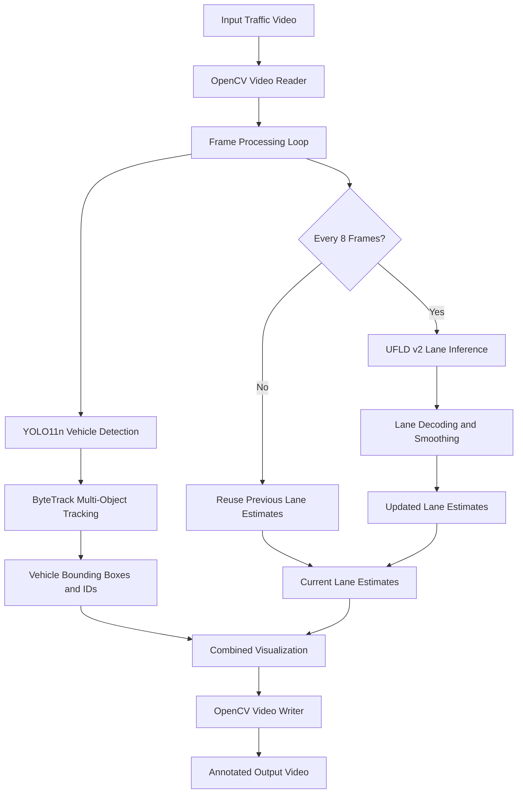

# Autonomous Driving Perception Stack
## Architecture and Data Flow

### 1. System Overview

The Autonomous Driving Perception Stack is a computer vision prototype that combines vehicle detection, multi-object tracking, and lane detection in a single video-processing pipeline.

The system processes an input traffic video frame by frame and generates an annotated output video.

### 2. Architecture Diagram



### 3. Main Components

| Component | Responsibility |
|---|---|
| OpenCV | Reads the input video, processes frames, draws annotations, and writes the output video. |
| YOLO11n | Detects vehicles in each frame. |
| ByteTrack | Associates detections across frames to maintain object tracking IDs. |
| Ultra-Fast Lane Detection v2 | Predicts lane markings from selected video frames. |
| Lane-processing utilities | Decode lane predictions, smooth estimates, and draw lane overlays. |
| Performance profiler | Measures processing time for inference, preprocessing, annotation, and video writing. |

### 4. Data Flow

1. OpenCV reads the input video and supplies frames to the processing loop.
2. YOLO11n detects vehicles in every frame.
3. ByteTrack associates detections across frames using persistent tracker state.
4. Lane inference runs every eight frames. Between inference steps, the latest lane estimates are reused and smoothed according to the implemented logic.
5. Vehicle annotations and lane overlays are combined on each frame.
6. OpenCV writes the annotated frames into the output video.
7. The pipeline reports processing statistics, including effective FPS and component timings.

### 5. Input Data and Model Artifacts

**Input data**
- Traffic video containing road scenes and vehicles.
- Video frames are processed sequentially.

**Model artifacts**
- `artifacts/models/yolo11n.pt`: vehicle detection and tracking model weights.
- `artifacts/models/culane_res18.pth`: lane-detection model checkpoint.

**External dependency**
- `external_models/Ultra-Fast-Lane-Detection-v2/`: external lane-detection implementation and associated configuration.

Model weights are excluded from Git and must be obtained separately from appropriate sources. Verify the relevant licenses before redistribution.

### 6. Output and Interfaces

**Output video:** `outputs/perception/integrated_traffic.mp4`

The output contains vehicle bounding boxes, tracking IDs, confidence labels, and lane overlays.

The current implementation is a local video-processing pipeline. It does not expose a documented HTTP REST API; the primary interface is the Python script:

```powershell
python tools/integrated_perception.py
```

Input paths, model paths, and output locations must match the project's local configuration.

### 7. Performance Results

Recorded CPU-only benchmark:

| Metric | Result |
|---|---:|
| Frames processed | 1,260 |
| Processing time | 181.00 seconds |
| Effective processing speed | 6.96 FPS |
| Lane inference interval | Every 8 frames |
| Video resolution | 1280 × 720 |

These are development benchmark results, not a real-time performance guarantee.

### 8. Known Limitations

- Lane estimates can deviate from road markings on curved roads.
- Reusing lane estimates between inference steps can delay adaptation to rapidly changing road geometry.
- Performance and detection quality depend on the input video, hardware, and model configuration.
- The system has not been validated for autonomous vehicle control or safety-critical use.